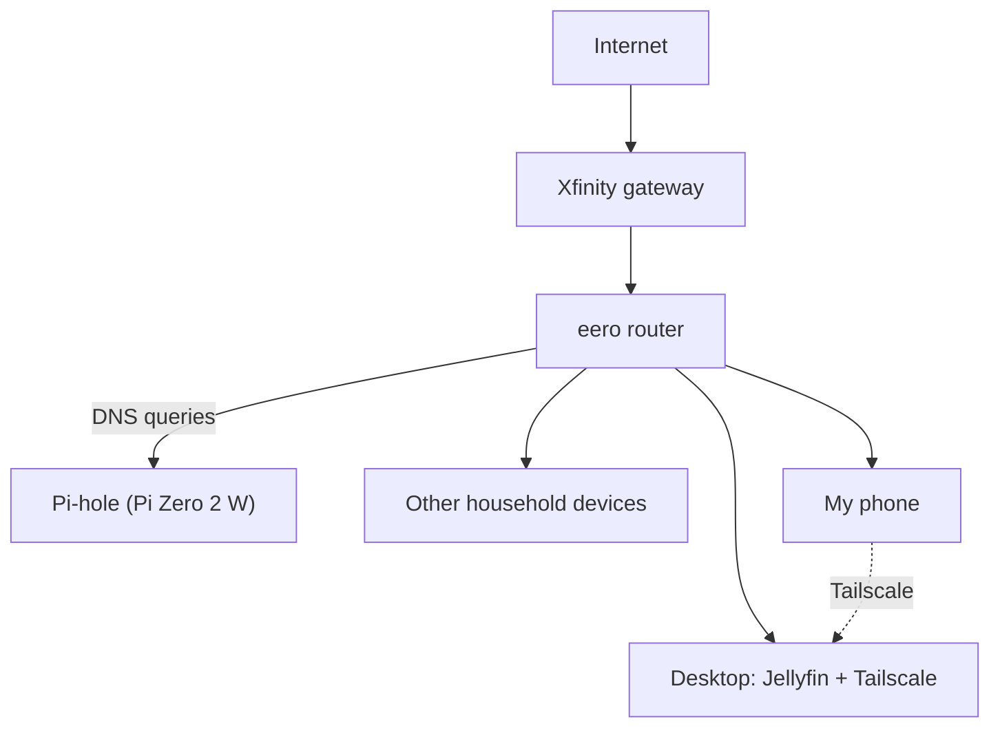

# Home Lab

My home network and self-hosted services, built to learn networking
and security hands-on.

## Network Diagram

## Services

### Pi-hole
*(coming soon)*

### Jellyfin
Jellyfin is a self-hosted media server. I run it on my desktop to stream
my own movies and shows to my other devices.

- **Runs on:** desktop PC
- **Access:** locally over home Wi-Fi, and remotely through Tailscale

### Tailscale
Tailscale creates a private network (a VPN) between my devices, so my
phone can reach my desktop from anywhere.

**Why Tailscale instead of port forwarding:** port forwarding exposes a
service to the whole internet, where anyone can scan and attack it.
With Tailscale, only devices signed in to my account can reach Jellyfin,
and I don't open any ports on my router.

**How I tested it:**
1. Installed Tailscale on my desktop and phone and signed in to the same account
2. Confirmed both devices appeared in the Tailscale admin console
3. Turned off Wi-Fi on my phone (cellular only)
4. Opened Jellyfin using the desktop's Tailscale address, and it loaded

**What I learned:** Each device gets its own private 100.x address, and
traffic between my devices is encrypted. That let me reach Jellyfin from
outside my home without opening any ports on my router.

## What I'm learning
-
