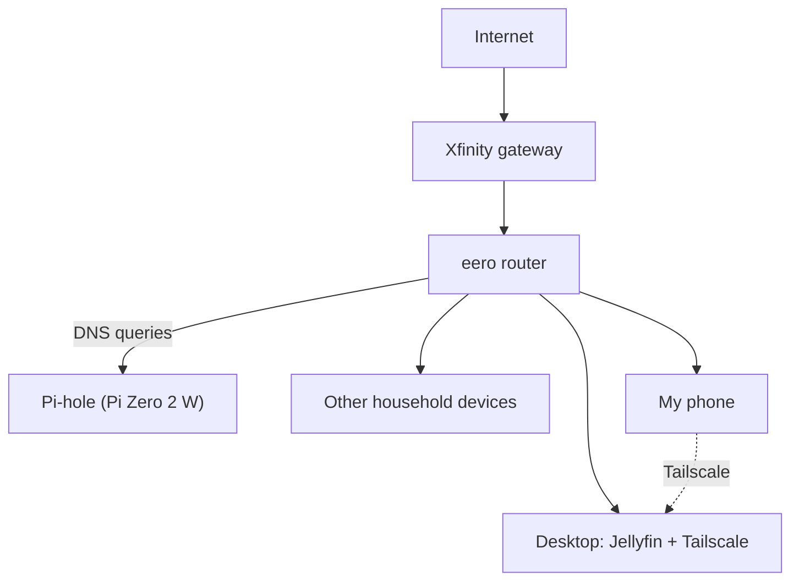

# Home Lab

My home network and self-hosted services, built to learn networking
and security hands-on.

## Network Diagram

## Services

### Pi-hole
*(coming soon)*

### Jellyfin
*(coming soon)*

### Tailscale
*(coming soon)*

## What I'm learning
-
