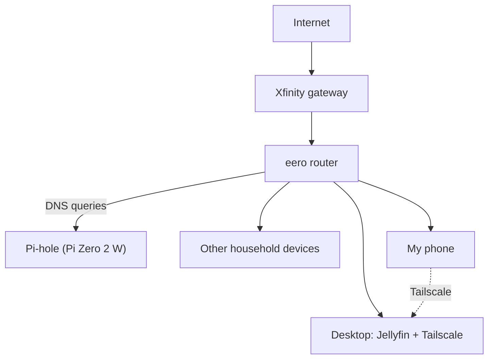
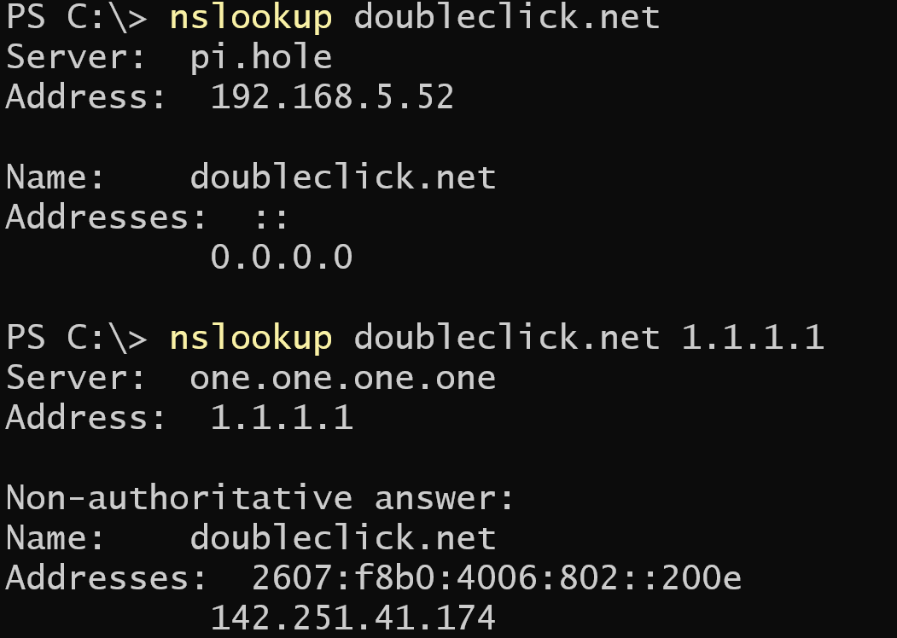
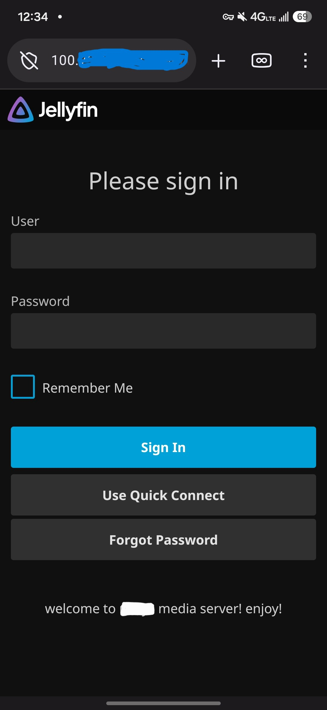

# Home Lab

My home network and self-hosted services, built to learn networking
and security hands-on.

## Network Diagram

## Services

### Pi-hole
Pi-hole is a DNS server that blocks ads and trackers for every device on
my network. It runs on a Raspberry Pi Zero 2 W, and my eero router is
set to use it for all DNS lookups.

**How it works:** when a device visits a site, it first asks a DNS server
to turn the name into an address. Pi-hole checks each name against
blocklists (about 78,000 domains). Blocked names get a dead-end answer
(`0.0.0.0`), and everything else is forwarded to a normal DNS server.

**How I tested it:** I looked up a known ad domain twice, once through
Pi-hole and once directly through Cloudflare (1.1.1.1):

    nslookup doubleclick.net
    nslookup doubleclick.net 1.1.1.1

Pi-hole returned `0.0.0.0` (blocked). Cloudflare returned a real address.

**What I learned:** DNS is the first step of almost every connection, so
a DNS server can see and filter traffic for the whole network. Some
devices and browsers bypass it with their own DNS settings.
### Jellyfin
Jellyfin is a self-hosted media server. I run it on my desktop to stream
my own movies and shows to my other devices.

- **Runs on:** desktop PC
- **Access:** locally over home Wi-Fi, and remotely through Tailscale

### Tailscale
Tailscale creates a private network (a VPN) between my devices, so my
phone can reach my desktop from anywhere.

**Why Tailscale instead of port forwarding:** port forwarding exposes a
service to the whole internet, where anyone can scan and attack it.
With Tailscale, only devices signed in to my account can reach Jellyfin,
and I don't open any ports on my router.

**How I tested it:**
1. Installed Tailscale on my desktop and phone and signed in to the same account
2. Confirmed both devices appeared in the Tailscale admin console
3. Turned off Wi-Fi on my phone (cellular only)
4. Opened Jellyfin using the desktop's Tailscale address, and it loaded

**What I learned:** Each device gets its own private 100.x address, and
traffic between my devices is encrypted. That let me reach Jellyfin from
outside my home without opening any ports on my router.

## What I'm learning
-
